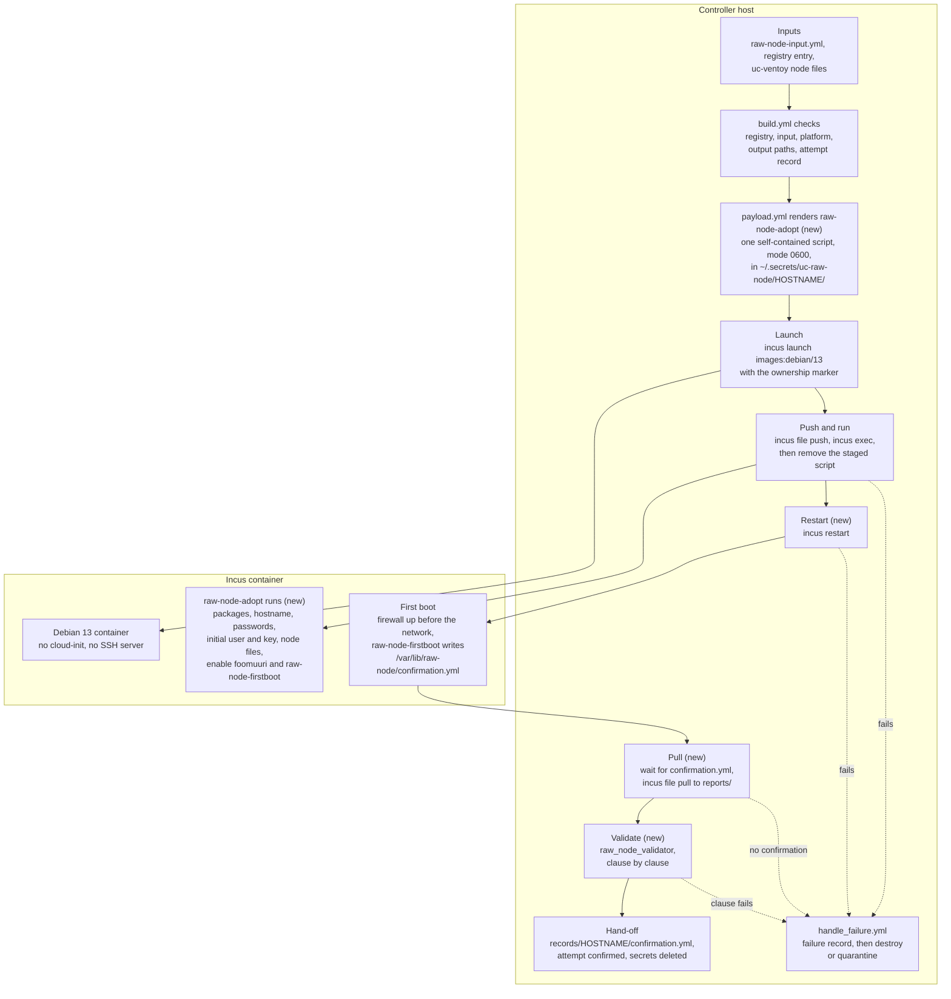

# Raw Node Payload Flow

- **Version:** 0.1.0
- **Date:** 2026-11-22
- **License:** Proprietary / Internal Use Only
- **Author:** Christopher Steel

## Purpose

This chart shows how `build.yml` builds the `raw-node-adopt` payload on the controller host, drops it into a Debian 13 Incus container and gets the node's confirmation back, for the priority 1 platform `incus_container_default`. The steps marked new are not in the code at `v0.3.0`. Launch, push, run, failure handling and teardown already work.

## Flow

## Notes

- **One file is the payload.** The two password hashes, the SSH public key and uc-ventoy's node files are written into `raw-node-adopt` itself, so the transport's existing push and run deliver it unchanged. The hashes reach `chpasswd -e` through the shell's `printf` built-in, never through a command line.
- **The restart makes it a raw node.** On that boot Foomuuri is in force before the network (RN-FW-04), and `raw-node-firstboot` measures the node and writes its confirmation (RN-REP-01).
- **The confirmation is the node's own.** The controller copies it to `records/` unchanged, so the orchestration controller receives exactly the contract's format.
- **Every failure goes the same way.** The failure record is written first, then the container is destroyed, or quarantined if teardown fails. The ownership marker means only a container this run created is ever deleted.

## Changes

### v0.1.0

- First version: the payload flow for `incus_container_default`, with the new steps marked and the failure paths.
