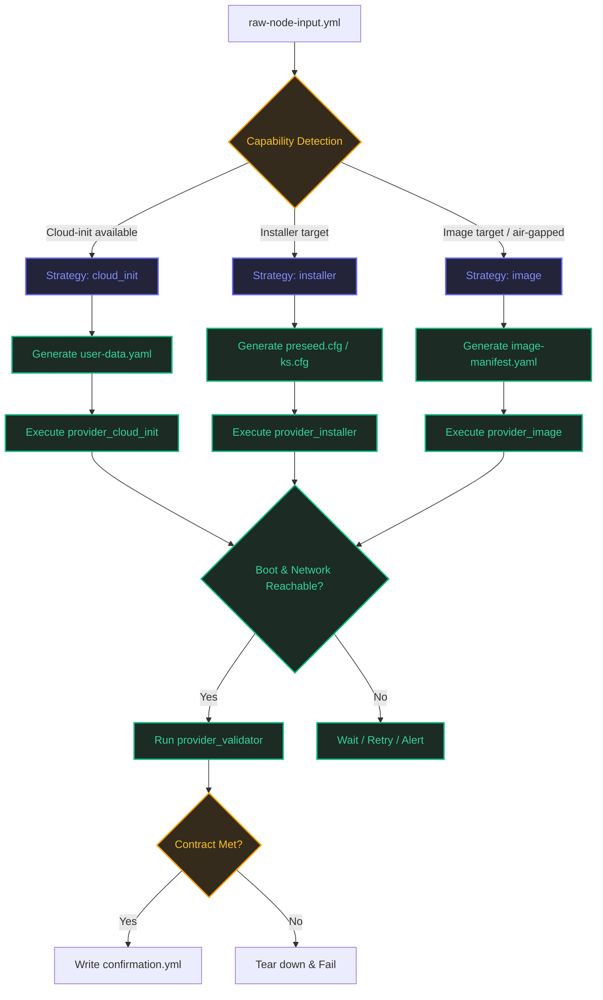

# Collapse Strategy for a raw node controller

The taxonomy you shared maps **discovery sources** and **infrastructure targets**, not creation mechanisms. Several entries overlap in how they actually build a node: AWS, GCP, Azure, Proxmox, libvirt, Incus, LXD, and Docker all support cloud-init injection. PXE, IPMI, and custom APIs are primarily delivery channels, not OS-level strategies.

To minimize complexity, the controller should collapse the taxonomy into **three delivery mechanisms** plus a **discovery layer**. This reduces sixteen source types to three provider roles, one validation pipeline, and a single capability-detection step.

## Collapse Strategy

| Category | Actual Creation Method | Controller Role |
|----------|----------------------|-----------------|
| Container / Hypervisor / Cloud | Cloud-init user-data injection | `provider_cloud_init` |
| Bare Metal / Offline / Legacy | Installer answer files (Preseed, Kickstart, Subiquity) | `provider_installer` |
| Air-gapped / High-throughput / Immutable | Pre-baked disk image or VM template | `provider_image` |
| Network / CMDB / Manual / Cloud inventory | Discovery only (handled by orchestration `00_discover.yml`) | Not a creation provider |

This approach guarantees that adding AWS, Proxmox, or Incus only changes configuration variables, not controller logic.

## Controller Routing Flow



## Platform-to-Strategy Decision Matrix

| Target Platform                                         | Primary Strategy     | Datasource / Injection Method                                | Fallback Strategy                          |
| :------------------------------------------------------ | :------------------- | :----------------------------------------------------------- | :----------------------------------------- |
| Incus, LXD, Proxmox, libvirt, VMware                    | `cloud_init`         | `nocloud` (local files) or `configdrive`                     | `installer` (if cloud-init stripped)       |
| AWS, GCP, Azure, Oracle Cloud                           | `cloud_init`         | Provider metadata endpoint (`aws`, `gce`, `azure`, `oracle`) | `installer` or `image`                     |
| DigitalOcean, Linode, Vultr, UpCloud, Hetzner, Scaleway | `cloud_init`         | Provider-specific datasource (`digitalocean`, `linode`, `vultr`, `upcloud`, `hetzner`, `scaleway`) | `installer`                                |
| Generic VPS / Shared Hosting                            | `cloud_init`         | `nocloud` or custom SSH drop-in                              | `image`                                    |
| Bare metal (enterprise / modern)                        | `installer`          | Preseed, Kickstart, Subiquity via PXE/USB                    | `cloud_init` (if network boot supports it) |
| Bare metal (legacy / air-gapped)                        | `image`              | Pre-baked disk/VM template deployed via `dd`, `rsync`, or DRBL | `installer`                                |
| CMDB / DHCP / ARP / Cloud inventory                     | N/A (discovery only) | Handled by orchestration `00_discover.yml`                   | N/A                                        |

Every modern VPS provider collapses into the `cloud_init` strategy. The only difference is the **datasource name** and whether the provider injects `vendor-data` or `meta-data` via a local HTTP metadata endpoint (common with DO, Linode, AWS, GCP) or via injected files (Incus, Proxmox, generic VPS). The controller treats them identically: inject `user-data`, wait for first boot, validate contract.Ansible Implementation Pattern

Dynamic role dispatch keeps the controller at a single entry point while isolating platform logic.

```yaml
# roles/raw_node_controller/tasks/main.yml
- name: Detect platform capability
 set_fact:
 raw_node_delivery_strategy: "{{ lookup('file', 'defaults/detection.yml') | default('cloud_init') }}"

- name: Generate platform artifacts
 include_tasks: tasks/{{ raw_node_delivery_strategy }}/artifacts.yml

- name: Execute delivery strategy
 include_role:
 name: "raw_node_provider_{{ raw_node_delivery_strategy }}"
 vars:
 raw_node_artifacts_dir: "{{ artifact_output_dir }}"

- name: Wait for node network reachability
 include_tasks: tasks/wait_for_boot.yml

- name: Validate contract
 include_role:
 name: raw_node_validator
```

`defaults/detection.yml` is a small YAML file mapping `target_platform` to `delivery_strategy`. Changing AWS from cloud-init to image deployment requires editing one line, not rewriting playbooks.

## Handling OS Configuration Variance Efficiently

1. **Init system detection:** The validator role runs `ps -p 1 -o comm=` to detect `systemd`, `openrc`, `sysvinit`, or `busybox`. Checks are conditional. Systemd units, timers, and masked services are only validated if systemd is present.
2. **Cloud-init fallback:** If cloud-init is missing, the installer provider injects a minimal `/etc/rc.local` or `cron @reboot` script that runs `raw-node-firstboot` once. The controller treats this as a degraded but acceptable path for air-gapped nodes.
3. **Network configuration:** Cloud images use `systemd-networkd` or `NetworkManager`. Installer targets use `ifcfg` or `netplan`. The validator reads `/etc/resolv.conf`, `ip route`, and `ip -4 addr` directly rather than assuming a manager. This avoids OS-specific parsing.
4. **Firewall consistency:** Regardless of delivery method, the controller enforces a single firewall strategy (Foomuuri or nftables bootstrap). The provider only ensures the service is enabled and the canonical ruleset is present; enforcement is verified identically in the validator role.

## Why This Solves the Complexity Problem

- **Single routing variable:** `raw_node_delivery_strategy` controls everything. No nested conditionals, no platform-specific playbook forks.
- **Artifact isolation:** Generation, execution, and verification are strictly separated. A broken Preseed generator doesn't break the cloud-init validator.
- **Discovery decoupling:** The taxonomy's network, DHCP, ARP, and CMDB entries feed into the orchestration controller's discovery stage, not the creation controller. Mixing them increases scope without adding value.
- **Predictable failure:** If a node boots but fails contract checks, the teardown is identical regardless of provider. The error trace points to the specific clause, not the delivery mechanism.

Run this routing pattern against your taxonomy. Every entry collapses into one of the three strategies, and the controller only needs to maintain three provider roles plus one universal validator.

## Should IaC Shims (Terraform, Pulumi, etc.) Be a Strategy?

**Short answer: No. They should sit outside the controller, not inside it.**

### Why IaC as a core strategy clouds the waters

1. **State management conflict:** IaC tools maintain persistent state files, drift detection, and plan/apply cycles. A raw node controller is designed for ephemeral provisioning: spin up, inject, verify, tear down. Embedding IaC state logic breaks the controller's disposal and retry flows.
2. **Cold-start overhead:** Terraform/Pulumi add significant initialization time. For rapid node creation workflows, direct provider APIs (`incus`, `virsh`, cloud CLIs) are faster and lighter.
3. **Coupling risk:** Tying the controller to Terraform or Pulumi ecosystems locks you into specific HCL or TypeScript patterns. If a provider changes its API or you pivot to a lightweight Python/Go automation layer, the controller becomes a bottleneck.
4. **Scope creep:** IaC solves infrastructure lifecycle, multi-region deployment, and drift remediation. The raw node controller only cares about delivery mechanism and contract validation. Mixing the two invites unnecessary complexity.

### Recommended boundary: IaC as an external orchestrator

Keep the controller focused on its three delivery strategies and contract validation. Treat Terraform/Pulumi/Ansible as **external callers** that invoke the controller as a role, CLI, or API.

**Pattern:**

text

Copy

```
[IaC Stack] → [Terraform/Pulumi Module] → [raw_node_controller CLI/Role] → [Platform API/CLI]
```

If you want IaC integration, provide a thin **IaC Adapter Role** that:

- Reads Terraform outputs or Pulumi stack references
- Translates them into `raw-node-input.yml` and provider dispatch variables
- Invokes the controller's dispatch logic
- Returns contract validation results as IaC outputs

This keeps the controller decoupled from state management while giving your broader ecosystem a clean integration point.

## Controller Architecture Recommendation

1. **Core Controller:** Exactly three strategies (`cloud_init`, `installer`, `image`) + discovery. No IaC logic inside.
2. **IaC Wrapper (Optional):** A lightweight role/module that maps Terraform/Pulumi outputs to controller inputs. Deploy it as a separate package or collection.
3. **Datasource Registry:** Maintain a small lookup table mapping common VPS providers to their cloud-init datasource names. The controller injects the correct metadata endpoint or local files based on this registry.
4. **Validation Pipeline:** Remains universal. Init system detection, firewall enforcement, and contract checks run identically regardless of delivery method.

This preserves the "least number of options" principle while giving you full coverage of modern VPS, cloud, and bare-metal targets. If you want, I can draft the IaC adapter role skeleton or the datasource registry structure next.