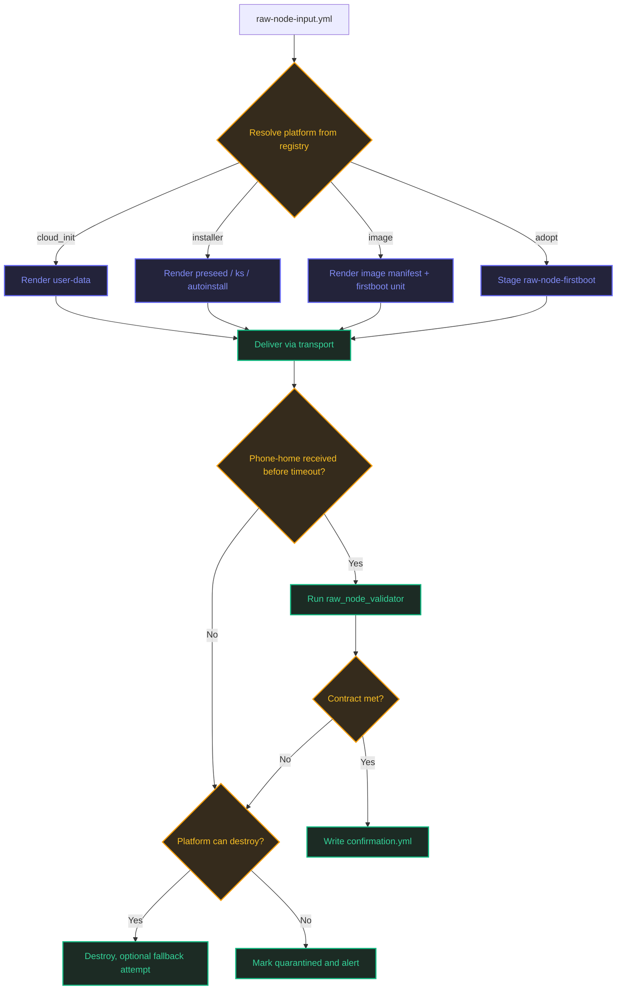

# Collapse Strategy for a raw node controller

Version 0.1.5

## Purpose and scope

uc-raw-node is the raw node controller. Its only job is to produce a node that meets the raw node contract (the RN-* clauses) from `raw-node-input.yml` (`root_password_hash`, `initial_username`, `initial_password_hash`, `ssh_public_key`) and to write `confirmation.yml` keyed by hostname (timestamp, ip, ip6, user, sudo) for the orchestration controller's inventory. Everything after that, discover, verify, onboard, normalize and customize, belongs to the orchestration controller.

The platform taxonomy maps **discovery sources** and **infrastructure targets**, not creation mechanisms. Several entries overlap in how they actually build a node: AWS, GCP, Azure, Proxmox, libvirt, Incus, LXD and most VPS providers all accept cloud-init user-data. PXE, IPMI, USB sticks and custom APIs are delivery channels, not OS-level strategies.

To minimize complexity, the controller collapses the taxonomy into **one payload**, **four delivery strategies** and a **transport registry**, with discovery left to the orchestration controller. Adding a platform should mean adding a registry entry, not changing controller logic.

## The common payload

Every strategy ends by running the same thing: create the initial user, install the SSH key, set the root password hash, apply the baseline nftables ruleset, and report back. This is packaged once as `raw-node-firstboot`, the canonical payload. A strategy only answers one question: how does this payload reach the node and get executed exactly once?

Keeping one payload means the RN-* clauses are implemented in one place and tested once, and the validator can check the same outcome no matter how the node was built.

## Delivery strategies

| Strategy | How the payload runs | Typical targets |
|----------|---------------------|-----------------|
| `cloud_init` | Rendered as cloud-config user-data, executed by cloud-init on first boot | Cloud, VPS with user-data, Incus/LXD cloud images, Proxmox, libvirt, VMware |
| `installer` | Embedded in an installer answer file (Preseed, Kickstart, Subiquity autoinstall) and run as a late command or first-boot unit | Bare metal via uc-ventoy USB or PXE, VPS with custom ISO |
| `image` | Baked into a disk image or template, triggered by a first-boot unit | Air-gapped, high-throughput, immutable, rescue-mode `dd` deployments |
| `adopt` | Pushed over a channel that already exists (SSH, `incus exec`, qemu guest agent) and run once | VPS without user-data, containers without cloud-init, nodes handed over by someone else |
| Discovery | Not a creation strategy, handled by the orchestration controller's `00_discover.yml` | CMDB, DHCP, ARP, cloud inventory |

The `adopt` strategy is new in this version. Without it, SSH-only VPS hosts and plain container images get forced into strategies that do not fit them.

## Payload format and transport

The v0.1.4 matrix mixed two independent things in one column. They are now separate:

- **Payload format** is decided by the strategy: cloud-config user-data, an answer file, an image manifest, or a bare `raw-node-firstboot` script.
- **Transport** is how that format reaches the node: a NoCloud seed (ISO, VFAT `CIDATA` volume or local files), a provider metadata endpoint, a platform API, PXE, a Ventoy USB stick, SSH, or `incus exec`.

Transport is where platforms actually differ, so it is the pluggable part. Each transport is a small role, and the registry says which strategy and transport a platform uses.

The boundary between `installer` and `cloud_init` is deliberately blurred for Ubuntu. Subiquity takes its autoinstall configuration through cloud-init, and in most cases the simplest route is user-data on the NoCloud datasource <a id="cite-canonical-autoinstall"></a>[(Canonical, n.d.-a)](#ref-canonical-autoinstall). uc-ventoy's Ubuntu path is therefore `installer` strategy with a NoCloud seed transport. This is correct, and should not be "fixed" later by moving it to `cloud_init`.

## Controller routing flow



The first gate is a registry lookup, not capability detection. An optional probe (for example, checking whether an image ships cloud-init) can refine the choice, but the registry is the source of truth.

## Platform-to-strategy decision matrix

| Target platform | Primary strategy | Transport / datasource | Fallback |
| :-- | :-- | :-- | :-- |
| Incus or LXD, `/cloud` image variants | `cloud_init` | Incus API, `cloud-init.user-data` config key | `adopt` via `incus exec` |
| Incus or LXD, default image variants | `adopt` | `incus exec`, `incus file push` | `cloud_init` after switching to a `/cloud` image |
| Proxmox, libvirt | `cloud_init` | `nocloud` seed or `configdrive` | `installer` |
| VMware | `cloud_init` | `vmware` datasource (guestinfo) or `ovf` | `installer` |
| AWS, GCP, Azure, Oracle Cloud | `cloud_init` | Provider metadata endpoint (`ec2`, `gce`, `azure`, `oracle`) | `image` |
| VPS with API and user-data (DigitalOcean, Akamai/Linode, Vultr, UpCloud, Hetzner Cloud, Scaleway) | `cloud_init` | Provider datasource, see the VPS analysis | `installer` via rescue or custom ISO |
| VPS with SSH only | `adopt` | SSH | `installer` via custom ISO, if offered |
| Bare metal, modern | `installer` | uc-ventoy USB, PXE | `image` |
| Bare metal, legacy or air-gapped | `image` | `dd`, `rsync` or DRBL from local media | `installer` |
| CMDB, DHCP, ARP, cloud inventory | Not a creation target | Orchestration controller `00_discover.yml` | Not applicable |

The datasource names above come from cloud-init's list of supported datasources, which includes VMware, OVF, NoCloud, ConfigDrive, LXD and the major clouds and VPS providers <a id="cite-canonical-datasources"></a>[(Canonical, n.d.-b)](#ref-canonical-datasources). "Generic VPS / Shared Hosting" from v0.1.4 is removed: shared hosting does not provide a node.

## Issue analysis

This section works through specific problems and decides, for each, which strategy and transport handle it and what the controller must do differently. It replaces a generic provider interface: the differences between platforms are captured as decisions here and as data in the registry.

### VPS providers

"VPS" covers four quite different situations, and each one maps to a different strategy.

#### API with user-data

Most mainstream providers accept cloud-init user-data at creation time and expose it through a metadata endpoint. This is the `cloud_init` strategy with the provider API as transport, and it is the fastest path.

Issues to handle:

- **Provider defaults compete with the contract.** Provider images often create their own default user, place the account's SSH keys on root, set the hostname from the panel, and may ship `vendor-data` that runs alongside user-data. The payload must assert the contract state explicitly (user, root hash, key, hostname) rather than assume a blank image, and the validator must check for unexpected authorized keys.
- **Hostname is the confirmation key.** Because `confirmation.yml` is keyed by hostname, the controller sets the hostname in user-data and the validator confirms it, rather than trusting the provider's metadata name.
- **Provider firewalls are separate.** Many providers have their own network firewall. It is outside the RN-* contract, but the controller must make sure it does not block SSH or the phone-home call, otherwise a correct node looks failed.
- **Agents.** Some images include provider monitoring or guest agents. Their presence is recorded in `confirmation.yml` notes rather than removed, so the orchestration controller can decide in 20_normalize.

#### SSH only

Budget providers and panel-based hosts often give a root password or key and nothing else. This is the `adopt` strategy with SSH as transport.

Issues to handle:

- **Unknown starting state.** The provider template is of unknown provenance. Where the panel allows it, reinstall the template immediately before adopting, so the starting state is at least fresh.
- **Credentials the provider knows.** The root password was issued by the provider. The payload replaces it with `root_password_hash`, which the contract already requires.
- **Host key trust.** The first SSH connection is trust-on-first-use. If the provider shows the host key fingerprint in its console, the controller compares it. Otherwise the risk is recorded in `confirmation.yml`.

#### Rescue mode or custom ISO

Some providers let you boot a rescue system or attach your own ISO. Hetzner, for example, provides a Debian-based rescue system with an `installimage` script that runs unattended when it finds an `/autosetup` file, and supports custom images <a id="cite-hetzner-installimage"></a>[(Hetzner Online, 2020)](#ref-hetzner-installimage). This path supports either the `installer` strategy (custom ISO with a NoCloud seed) or the `image` strategy (`dd` or `installimage` from rescue).

It is slower and needs console or rescue access, but it is the only VPS path where the controller, not the provider, decides what is on the disk. For clients where provenance and the ability to migrate matter, this should be the preferred path even when user-data is available.

#### Container-based VPS

Some low-cost "VPS" products are actually containers on a shared kernel (OpenVZ or LXC style). Kernel modules, and sometimes nftables, may not be available inside them, so the baseline firewall clause may be impossible to meet. The controller should detect this (through the registry entry, or by checking that `nft list ruleset` works) and fail with a clear "contract cannot be met on this platform" error rather than produce a node that looks compliant but is not.

#### Choosing among them

The registry records, per VPS provider, which of these modes it supports. The controller's default order is: rescue or custom ISO when the client's provenance requirements call for it, otherwise user-data, otherwise SSH adoption. Container-based VPS products are rejected unless a contract waiver is defined.

### Containers on Incus and LXD

Images from the `images:` remote come in default and `/cloud` variants, and only the `/cloud` variants include cloud-init. Incus VMs also need either a working `incus-agent` or an extra cloud-init disk for the configuration to reach the guest <a id="cite-incus-cloudinit"></a>[(Linux Containers, n.d.)](#ref-incus-cloudinit).

Decisions:

- **`/cloud` variants** use `cloud_init` with the Incus API as transport.
- **Default variants** use `adopt` with `incus exec` and `incus file push`. The installer fallback listed in v0.1.4 is removed, because containers do not run installers.
- **Address.** Incus reports the instance address through its API, so phone-home is optional here, but it is still used so that every strategy produces the same evidence.
- **Firewall inside unprivileged containers** may be restricted. As with container-based VPS, the registry should record whether the baseline nftables clause applies.

### Local hypervisor VMs

Proxmox, libvirt and Incus VMs all accept a NoCloud seed or config drive, and this is the most predictable `cloud_init` path. The main issue is cleanup: the seed volume holds credentials (see credential exposure) and should be detached after the node passes validation.

### Bare metal with uc-ventoy or PXE

This is the `installer` strategy. uc-ventoy already renders the answer files on the workstation and stores only its output on the stick. The controller treats uc-ventoy as the transport for this case rather than reimplementing it.

The issues specific to this case are that the controller cannot see the machine boot, does not know its address, and cannot destroy it. Phone-home is therefore mandatory here, and failure handling ends in quarantine, not teardown.

### Air-gapped and immutable targets

This is the `image` strategy. The payload is baked into the image and triggered by a first-boot unit that removes itself after running. With no network path back to the controller, phone-home writes its report to local media (or a known path for later collection), and the validator runs when the orchestration controller can reach the node.

### Finding the node

`wait_for_boot` in v0.1.4 assumed the controller already knew the node's IP. That is true for Incus and cloud APIs, but not for bare metal or SSH-handed-over VPS hosts.

Every strategy now ends the payload with a phone-home call. cloud-init has a `phone_home` module that posts data, including the SSH host public keys, instance ID and hostname, to a URL after boot <a id="cite-canonical-phonehome"></a>[(Canonical, n.d.-c)](#ref-canonical-phonehome). The `installer`, `image` and `adopt` payloads send the same POST themselves. Sending the host keys also solves trust-on-first-use for the validator's SSH connection.

The report maps directly onto `confirmation.yml`. Each attempt includes a one-time token in the payload, so the receiver can reject unexpected reports.

There is one practical issue for VPS targets: a controller on a workstation behind NAT cannot receive a callback from the internet. The options are a small, always-on receiver on a host the client controls, or polling the provider API for the address. The receiver is preferred, since it works the same way for every target.

### Failure and teardown

v0.1.4 said teardown was identical across providers. It is not. The registry carries a `can_destroy` flag per platform:

- **Destroyable** (cloud, VPS with API, Incus, local hypervisors): destroy the node, keep the logs and the failed artifacts, and optionally make one fallback attempt.
- **Not destroyable** (bare metal, SSH-adopted VPS, nodes handed over by someone else): mark the node as quarantined in a failure record, alert, and never retry automatically.

The error report always names the RN-* clause that failed, not the delivery mechanism.

### Fallback selection

Fallback is chosen in one of two ways, never silently:

- **Before delivery**, when a probe or registry entry shows the primary strategy cannot work (for example, an Incus image without cloud-init). This is automatic and logged.
- **After failure**, only for destroyable platforms, and only once. On non-destroyable platforms it is a manual decision.

### Credential exposure

The payload carries password hashes and an SSH key, and every transport leaves a copy somewhere:

- **Metadata endpoints.** On clouds such as AWS, user-data stays readable from inside the instance through the metadata service. Instances should be launched requiring IMDSv2 (token-based requests) <a id="cite-aws-imdsv2"></a>[(Amazon Web Services, n.d.)](#ref-aws-imdsv2). Hashes are acceptable in user-data; plaintext secrets are not.
- **Seed media.** Detach NoCloud seed volumes and config drives after validation.
- **USB and PXE.** uc-ventoy output on the stick and PXE answer files should be treated as credentials and removed or rotated after the install batch.
- **Payload cleanup.** `raw-node-firstboot` deletes its own staged copy and the phone-home token after running.

### Init systems and degraded paths

The validator detects the init system with `cat /proc/1/comm` (or `readlink /proc/1/exe`) rather than `ps -p 1 -o comm=`, which fails on BusyBox. Checks are conditional: systemd units and timers are only validated if systemd is PID 1.

When cloud-init is missing and the payload must schedule itself, the degraded paths have preconditions that must be checked rather than assumed: `/etc/rc.local` on systemd needs `rc-local.service`, and `cron @reboot` needs a cron daemon installed and enabled. A systemd oneshot unit that disables itself is preferred wherever systemd is present.

For networking, the validator continues to read `ip -4 addr`, `ip -6 addr`, `ip route` and `/etc/resolv.conf` directly, without assuming a network manager.

### Firewall scope

The raw node contract only asks for the baseline nftables ruleset. The controller ensures that baseline is present and that SSH stays reachable. Foomuuri management, and any richer policy, belongs to the orchestration controller's 20_normalize stage. This keeps the raw node layer minimal and avoids a firewall change locking the controller out before `confirmation.yml` is written.

## Ansible implementation pattern

A single entry point resolves the platform from the registry, renders the common payload, and hands off to the strategy and transport.

```yaml
# roles/raw_node_controller/tasks/main.yml
- name: Load platform registry
  ansible.builtin.include_vars:
    file: registry.yml
    name: raw_node_registry

- name: Resolve platform entry
  ansible.builtin.set_fact:
    raw_node_platform: "{{ raw_node_registry.platforms[target_platform] }}"

- name: Resolve delivery strategy
  ansible.builtin.set_fact:
    raw_node_delivery_strategy: "{{ raw_node_strategy_override | default(raw_node_platform.strategy) }}"

- name: Assert strategy is known
  ansible.builtin.assert:
    that:
      - raw_node_delivery_strategy in ['cloud_init', 'installer', 'image', 'adopt']

- name: Build, deliver and validate
  block:
    - name: Render raw-node-firstboot payload
      ansible.builtin.include_tasks: payload.yml

    - name: Render strategy artifacts
      ansible.builtin.include_tasks: "{{ raw_node_delivery_strategy }}/artifacts.yml"

    - name: Deliver through transport
      ansible.builtin.include_role:
        name: "raw_node_transport_{{ raw_node_platform.transport }}"

    - name: Wait for phone-home report
      ansible.builtin.include_tasks: wait_for_phone_home.yml

    - name: Validate contract
      ansible.builtin.include_role:
        name: raw_node_validator

    - name: Write confirmation.yml
      ansible.builtin.include_tasks: write_confirmation.yml

  rescue:
    - name: Handle failure by platform capability
      ansible.builtin.include_tasks: failure.yml
```

The registry is plain data. Changing a platform's strategy or transport is a one-line edit.

```yaml
# roles/raw_node_controller/vars/registry.yml
platforms:
  incus_vm_cloud:
    strategy: cloud_init
    transport: incus
    datasource: nocloud
    can_destroy: true
    reports_address: true
  incus_container_default:
    strategy: adopt
    transport: incus_exec
    can_destroy: true
    reports_address: true
    firewall_clause: check
  hetzner_cloud:
    strategy: cloud_init
    transport: hetzner_api
    datasource: hetzner
    can_destroy: true
    reports_address: true
  vps_ssh_only:
    strategy: adopt
    transport: ssh
    can_destroy: false
    reports_address: false
  metal_ventoy:
    strategy: installer
    transport: ventoy_usb
    can_destroy: false
    reports_address: false
```

## Why this solves the complexity problem

- **One payload:** the RN-* clauses are implemented once, in `raw-node-firstboot`, and validated once.
- **Single routing decision:** the registry entry for `target_platform` sets strategy and transport. There are no nested conditionals and no platform-specific playbook forks.
- **Differences are data:** per-platform behaviour (can it be destroyed, does it report an address, does the firewall clause apply) lives in the registry, informed by the issue analysis, not in code.
- **Artifact isolation:** generation, delivery and verification stay separate. A broken Preseed generator does not break the cloud-init path.
- **Discovery decoupling:** network, DHCP, ARP and CMDB sources feed the orchestration controller's discovery stage, not this controller.
- **Predictable failure:** failures name the RN-* clause that failed, and the response (destroy or quarantine) follows from the registry, not from improvisation.

## Should IaC shims (Terraform, OpenTofu, Pulumi) be a strategy?

**Short answer: no. They should sit outside the controller.**

### Why IaC as a core strategy clouds the waters

- **Scope:** IaC tools manage infrastructure lifecycle, multi-region layouts and drift. uc-raw-node only cares about getting one node to meet the contract. Mixing the two widens the controller's responsibility without adding value to that job.
- **Competing state:** IaC tools keep authoritative state with plan and apply cycles. The controller keeps only a small attempt record (which nodes it created, which attempt is in flight) so it can retry and clean up safely. Two sources of truth for the same node invite conflict.
- **Coupling:** tying the controller to one IaC ecosystem locks in its language and provider plugins, which works against the goal of infrastructure that can be migrated over time.

Start-up time was given as a reason in v0.1.4. It is a minor factor and is no longer used as an argument.

### Recommended boundary: IaC as an external caller

IaC stacks call the controller, not the other way round.

```text
[IaC stack] → [Terraform/OpenTofu/Pulumi module] → [uc-raw-node CLI or role] → [platform API or transport]
```

A thin **IaC adapter**, packaged separately, can:

- Read Terraform or OpenTofu outputs, or Pulumi stack references
- Translate them into `raw-node-input.yml` and a `target_platform` key
- Invoke the controller
- Return the contents of `confirmation.yml`, or the failure record, as IaC outputs

## Controller architecture recommendation

- **Core controller:** one payload, four strategies (`cloud_init`, `installer`, `image`, `adopt`), transport roles, and the platform registry. No IaC logic and no discovery inside.
- **Platform registry:** one entry per platform with strategy, transport, datasource, `can_destroy`, `reports_address` and any contract caveats. VPS entries also record which modes (user-data, SSH only, rescue or custom ISO) the provider supports.
- **Phone-home receiver:** a small endpoint on a host the client controls, used by every strategy.
- **Validation pipeline:** universal. Init system detection, baseline firewall and RN-* checks run identically regardless of delivery method.
- **IaC adapter (optional):** a separate package that maps IaC outputs to controller inputs.

## Open questions

- Is `adopt` the right name, or does `bootstrap` read better next to the other three?
- Should post-failure fallback exist at all in the first release, or should every fallback be manual until the strategies are proven?
- Where does the phone-home receiver live for Vishpala clients: on the client's infrastructure, or on a small shared relay?
- Should container-based VPS and unprivileged containers get a defined contract waiver for the firewall clause, or be rejected outright?
- Is the `image` strategy needed for the first release, or can it wait until an air-gapped client needs it?

## Changes from v0.1.4

- Added the common `raw-node-firstboot` payload and the `adopt` strategy.
- Split payload format from transport, and replaced `defaults/detection.yml` with a platform registry.
- Replaced the provider-interface idea with an issue analysis covering VPS providers, containers, local VMs, bare metal, air-gapped targets, node location, failure, fallback, credentials, init systems and firewall scope.
- Replaced `wait_for_boot` with phone-home, and made teardown depend on whether the platform can be destroyed.
- Corrected the VMware datasource, removed shared hosting, and removed the installer fallback for containers.
- Fixed the Ansible snippet (indentation, registry lookup, failure handling) and unified the validator name as `raw_node_validator`.
- Moved Foomuuri management to the orchestration controller.
- Removed chat residue and paste artifacts, and added references.

## References

<a id="ref-aws-imdsv2"></a>Amazon Web Services. (n.d.). *Modify instance metadata options for existing instances*. Amazon Elastic Compute Cloud User Guide. https://docs.aws.amazon.com/AWSEC2/latest/UserGuide/configuring-IMDS-existing-instances.html
[Return to citation](#cite-aws-imdsv2)

<a id="ref-canonical-autoinstall"></a>Canonical. (n.d.-a). *Automated server installs*. Ubuntu Discourse. https://discourse.ubuntu.com/t/automated-server-installs/16612
[Return to citation](#cite-canonical-autoinstall)

<a id="ref-canonical-datasources"></a>Canonical. (n.d.-b). *Datasources*. cloud-init documentation. https://docs.cloud-init.io/en/latest/reference/datasources.html
[Return to citation](#cite-canonical-datasources)

<a id="ref-canonical-phonehome"></a>Canonical. (n.d.-c). *Phone home: Post data to remote host*. cloud-init documentation. https://docs.cloud-init.io/en/24.4/reference/yaml_examples/phone_home.html
[Return to citation](#cite-canonical-phonehome)

<a id="ref-hetzner-installimage"></a>Hetzner Online. (2020, May 18). *Installimage*. Hetzner Docs. https://docs.hetzner.com/robot/dedicated-server/operating-systems/installimage/
[Return to citation](#cite-hetzner-installimage)

<a id="ref-incus-cloudinit"></a>Linux Containers. (n.d.). *How to use cloud-init*. Incus documentation. https://linuxcontainers.org/incus/docs/main/cloud-init/
[Return to citation](#cite-incus-cloudinit)
