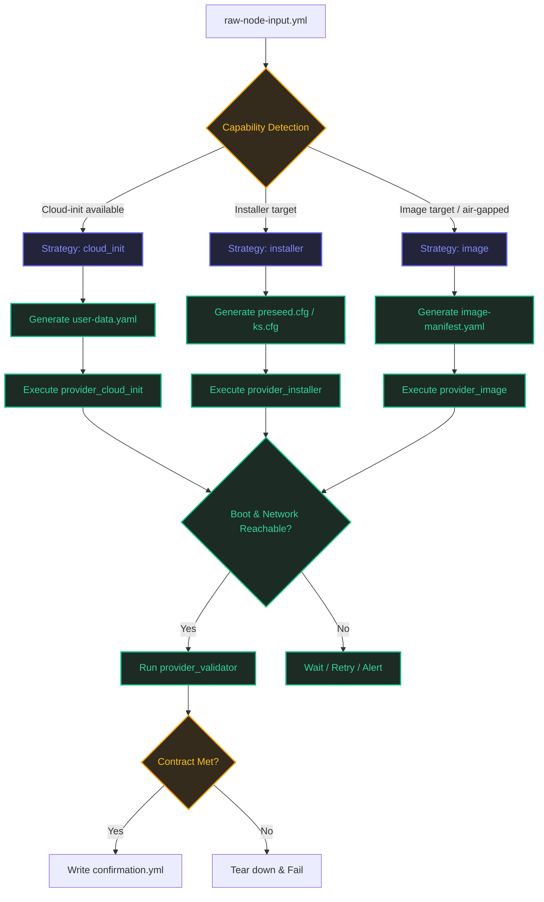

The taxonomy you shared maps **discovery sources** and **infrastructure targets**, not creation mechanisms. Several entries overlap in how they actually build a node: AWS, GCP, Azure, Proxmox, libvirt, Incus, LXD, and Docker all support cloud-init injection. PXE, IPMI, and custom APIs are primarily delivery channels, not OS-level strategies.

To minimize complexity, the controller should collapse the taxonomy into **three delivery mechanisms** plus a **discovery layer**. This reduces sixteen source types to three provider roles, one validation pipeline, and a single capability-detection step.

## Collapse Strategy

| Category | Actual Creation Method | Controller Role |
|----------|----------------------|-----------------|
| Container / Hypervisor / Cloud | Cloud-init user-data injection | `provider_cloud_init` |
| Bare Metal / Offline / Legacy | Installer answer files (Preseed, Kickstart, Subiquity) | `provider_installer` |
| Air-gapped / High-throughput / Immutable | Pre-baked disk image or VM template | `provider_image` |
| Network / CMDB / Manual / Cloud inventory | Discovery only (handled by orchestration `00_discover.yml`) | Not a creation provider |

This approach guarantees that adding AWS, Proxmox, or Incus only changes configuration variables, not controller logic.

## Controller Routing Flow



## Platform-to-Strategy Decision Matrix

| Target Platform | Primary Strategy | Fallback Strategy | OS/Config Notes |
|----------------|------------------|-------------------|-----------------|
| Incus, LXD, Proxmox, libvirt, VMware, AWS, GCP, Azure, DO | `cloud_init` | `installer` (if cloud-init stripped) | Cloud images ship cloud-init. Use `cloud-init-strict` mode for predictable first-boot. |
| Bare metal (enterprise) | `installer` | `cloud_init` (if PXE + cloud-init supported) | Preseed/Kickstart/Subiquity answer files. Requires network boot or USB. |
| Bare metal (legacy / air-gapped) | `image` | `installer` | Pre-baked disk image deployed via dd, rsync, or DRBL. No network dependency. |
| Embedded / Non-systemd | `image` or `installer` | `cloud_init` (busybox-compatible) | Validator must detect init system and skip systemd-specific checks. |
| CMDB / DHCP / ARP discovered | N/A (discovery only) | N/A | Handled by orchestration controller. Creation already occurred. |

## Ansible Implementation Pattern

Dynamic role dispatch keeps the controller at a single entry point while isolating platform logic.

```yaml
# roles/raw_node_controller/tasks/main.yml
- name: Detect platform capability
 set_fact:
 raw_node_delivery_strategy: "{{ lookup('file', 'defaults/detection.yml') | default('cloud_init') }}"

- name: Generate platform artifacts
 include_tasks: tasks/{{ raw_node_delivery_strategy }}/artifacts.yml

- name: Execute delivery strategy
 include_role:
 name: "raw_node_provider_{{ raw_node_delivery_strategy }}"
 vars:
 raw_node_artifacts_dir: "{{ artifact_output_dir }}"

- name: Wait for node network reachability
 include_tasks: tasks/wait_for_boot.yml

- name: Validate contract
 include_role:
 name: raw_node_validator
```

`defaults/detection.yml` is a small YAML file mapping `target_platform` to `delivery_strategy`. Changing AWS from cloud-init to image deployment requires editing one line, not rewriting playbooks.

## Handling OS Configuration Variance Efficiently

1. **Init system detection:** The validator role runs `ps -p 1 -o comm=` to detect `systemd`, `openrc`, `sysvinit`, or `busybox`. Checks are conditional. Systemd units, timers, and masked services are only validated if systemd is present.
2. **Cloud-init fallback:** If cloud-init is missing, the installer provider injects a minimal `/etc/rc.local` or `cron @reboot` script that runs `raw-node-firstboot` once. The controller treats this as a degraded but acceptable path for air-gapped nodes.
3. **Network configuration:** Cloud images use `systemd-networkd` or `NetworkManager`. Installer targets use `ifcfg` or `netplan`. The validator reads `/etc/resolv.conf`, `ip route`, and `ip -4 addr` directly rather than assuming a manager. This avoids OS-specific parsing.
4. **Firewall consistency:** Regardless of delivery method, the controller enforces a single firewall strategy (Foomuuri or nftables bootstrap). The provider only ensures the service is enabled and the canonical ruleset is present; enforcement is verified identically in the validator role.

## Why This Solves the Complexity Problem

- **Single routing variable:** `raw_node_delivery_strategy` controls everything. No nested conditionals, no platform-specific playbook forks.
- **Artifact isolation:** Generation, execution, and verification are strictly separated. A broken Preseed generator doesn't break the cloud-init validator.
- **Discovery decoupling:** The taxonomy's network, DHCP, ARP, and CMDB entries feed into the orchestration controller's discovery stage, not the creation controller. Mixing them increases scope without adding value.
- **Predictable failure:** If a node boots but fails contract checks, the teardown is identical regardless of provider. The error trace points to the specific clause, not the delivery mechanism.

Run this routing pattern against your taxonomy. Every entry collapses into one of the three strategies, and the controller only needs to maintain three provider roles plus one universal validator.

Revenez quand vous voulez.